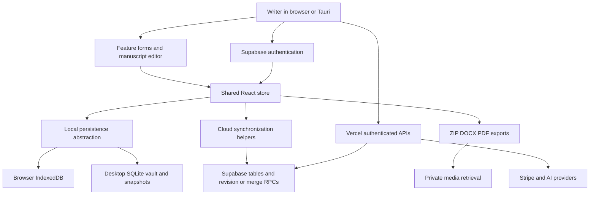

# Your Own World — Technical Audit

**Status: PARTIAL audit with broad repository coverage and targeted verification of high-risk paths.**

**Commercial readiness verdict: RED — not technically ready for wider paid adoption until the confirmed data-persistence, export and entitlement defects are resolved.**

Repository: `/Users/bishop/Desktop/Claude/yow`  
Commit examined: `a7c48d703cdef053091f6658e77d4c82b1500d24`  
Checks and initial review: 19 October 2026; resumed review and report: 22 October 2026. HEAD remained unchanged on resumption.  
Scope: source, committed migrations/configuration, existing automated checks and isolated synthetic probes. No production access, customer data access, deployment, database changes, dependency installation, commits or application-code fixes.

This report supersedes the earlier untracked, shorter audit at this filename. Its original content was preserved at `/tmp/yow-technical-audit-before-20261022.md`. The report is the only repository file changed by this assessment. The requested priorities and 30-day plan below are audit recommendations, not changes to the canonical roadmap. Implementation status remains in [docs/ROADMAP.md:7](/Users/bishop/Desktop/Claude/yow/docs/ROADMAP.md:7); payment follow-up belongs in [docs/PAYMENT_ROADMAP.md:1](/Users/bishop/Desktop/Claude/yow/docs/PAYMENT_ROADMAP.md:1). Neither planning document was edited because this assignment explicitly prohibits changes to existing application/planning material beyond the requested report.

“Confirmed” means either an actual isolated probe reproduced the stated behaviour or the cited source directly establishes it. It does **not** mean a customer has experienced the failure. “Suspected” means a plausible consequence needs an integrated test. Production deployment and configuration remain unverified unless expressly stated otherwise. Prior roadmap descriptions of owner tests are historical evidence, not tests performed in this audit.

## A. Executive summary

YOW is a substantial application with useful engineering safeguards, not an empty prototype. It has a broad test suite, private-media design, ownership checks, transactional replacement operations, scene revision checks, conflict preservation and portable project exports. Those protections demonstrate intentional engineering effort.

However, the protection is inconsistent across different ways of saving the same data. Ordinary saves, login recovery, sign-out, deletion, import and bulk replacement do not share one reliable definition of “saved.” Several defects are directly reproducible:

- A failed collection save is treated as the new comparison baseline, so the next attempt can skip the unsaved record.
- A successful unrelated write can clear a previous cloud error and report “synced.” The manuscript indicator also maps cloud errors to “saved.”
- An IndexedDB write can report success before its transaction commits, including when the transaction subsequently aborts.
- Sign-out proceeds after a failed flush, while the sign-out handler clears the local project copy.
- Login recovery stops preferring an unsynced local edit after 30 minutes; when local data wins, it republishes the whole snapshot through unguarded upserts.
- PDF export removes non-Latin writing rather than preserving it or reporting unsupported characters.
- Payment fulfilment can return success after a failed entitlement write; a Cloud-maintenance subscription event can replace a Lifetime licence marker.

These are significant reliability and trust problems. They justify RED even though no production compromise has been demonstrated and the existing unit suite passes. At present, I would not recommend treating YOW as the only safe copy of an important manuscript or expanding paid access on the assumption that autosave and recovery are proven.

The central weakness is correctness at transitions: offline to online, local to cloud, account A to account B, an edited record to its deleted state, and a paid invoice to a durable entitlement. A full rewrite is not justified. The immediate work is to make these transitions explicit, durable and testable, then consolidate the persistence paths incrementally.

This is **not a completed certification of every feature**. All requested subsystems were inventoried; the deepest review covered persistence, authentication boundaries, billing, account lifecycle, imports/exports and database policy source. Full live two-user security tests, browser/mobile journeys, packaged desktop behaviour, production backup restoration, workload benchmarks and an exhaustive line-by-line review remain outstanding. The coverage and continuation tables identify those gaps.

### Architecture and repository discovery

| Area | Observed implementation and important dependencies |
| --- | --- |
| Web application | React 19, Vite 8, predominantly JavaScript/JSX. `main.jsx` bootstraps storage and React; `App.jsx` owns routing, account loading, workspace composition and many lifecycle transitions. Routing uses application state/history rather than a general-purpose router dependency. |
| State | A 4,291-line `useStore.js` manages project collections, persistence, conflicts, deletion, import/export, membership restrictions and domain operations. Feature components consume this shared store. A mistake in a central collection operation can affect many features. |
| Browser persistence | `projectStorage` abstracts an in-memory mirror backed by IndexedDB; fallback storage paths exist. Scene prose and tracked changes use per-scene keys. Cross-tab coordination and scene editing leases reduce collisions but do not establish cross-device correctness by themselves. |
| Desktop | Tauri 2/Rust, native SQLite vault, snapshots, restore and native export dialogs. Desktop entitlement and Cloud access are separate concerns. Browser and desktop share much of the React/store layer but use different durability mechanisms. |
| Cloud data | Supabase Auth, PostgreSQL JSONB entity tables, RPCs and private Storage. `firestoreSync.js` is a legacy filename for Supabase access, not evidence of active Firestore use. One account load issues settings plus collection queries; it does not paginate. |
| Autosave | Editor buffer to store after roughly 400 ms; local draft persistence has a separate throttle; normal cloud scene writes use a serialized/debounced revision-aware path; entity collections use a two-second debounce and merge RPC. Recovery and some bulk operations take separate paths. |
| Identity and access | `AuthContext` uses Supabase sessions. Server handlers validate bearer identity; reviewed entitlement checks use server-controlled `app_metadata`. RLS and Storage policies are the database security boundary. UI membership restrictions alone are not security. |
| APIs | 15 tracked API files: 12 route handlers and 3 helpers. Features include Stripe checkout/portal/webhook, AI proxy/settings, desktop devices/downloads, feedback/interest and lifecycle cron operations. |
| AI | Google, Anthropic, OpenRouter and allowed OpenAI-compatible endpoints through a server proxy. User keys are locally stored; optional synced settings use server-side AES-GCM encryption. Provider keys and selected manuscript context necessarily reach the proxy/provider. |
| Export/import | Authoritative JSON project payload in ZIP with embedded private media; supplemental readable exports; `docx` for Word output; custom PDF writer; multiple DOCX/PDF/structured-project import paths. Different paths have different fidelity limits. |
| Background work | Browser debounces, flush handlers, storage retries, snapshots and AI requests; Vercel crons for account lifecycle; Supabase email Edge Functions. Automatic account cleanup is particularly sensitive to notice and deletion state. |
| Build/deployment | Vercel configuration and security headers; QA GitHub workflow; separate manual macOS/Windows packaging workflows. Actual branch protection, deployed migration state, signing, environment values and release rollback readiness were not inspected live. |
| Observability | Error boundaries, console/server logs and analytics are visible. No evidence was established of a complete alerting, save-failure monitoring or incident-response system. Console output is not an operational alerting strategy. |

The architecture has deliberate layers, but repeated feature additions have accumulated multiple overlapping persistence and lifecycle paths. The most important dependency is the shared store → local storage → cloud synchronization chain. Feature-level validation cannot compensate for failures in that chain.

Tracked-file inventory: 400 under `src`, 15 under `api`, 50 under `supabase` (39 migrations, 10 function files and configuration), 25 under `src-tauri`, 88 under `tests`, 36 under `scripts`, 76 under `public`, 180 under `docs`, and 3 workflow files. Other tracked material includes root build/config files, agent instructions, mockups and historical/recovery artifacts. Recovery material was inventoried, not mined for private content. No real secrets or local credential files were opened.

There are 264 production JS/JSX files under `src` and `api`, and no TS/TSX files in those two trees. Deno Edge Functions and Rust are separate. Particularly large modules include `useStore.js` (4,291 lines), `YOWMapBuilder.jsx` (3,770), `AccountSettings.jsx` (3,447), `mapDraw.js` (3,004), `SceneEditor.jsx` (2,540), `projectExportPdf.js` (1,968), `NovelManager.jsx` (1,918), `AIImportModal.jsx` (1,853), `Manuscript.jsx` (1,786) and `App.jsx` (1,756). Size alone is not a bug; mixing several consistency responsibilities in these modules is the risk.

### Checks actually performed

| Check | Result | Limits |
| --- | --- | --- |
| Existing Vitest suite, with placeholder Supabase URL/key and cache disabled | **171 files, 1,642 tests passed**, 42.48 seconds | Mocked/jsdom tests. Canvas/navigation “not implemented” warnings occurred. No real cloud writes or actual browser coverage implied. |
| ESLint | **0 errors, 123 warnings** | No automatic fixes. Warnings remain and require triage; lint is not type checking. |
| Local-module load check | **245 modules passed** | Resolution/parsing checks, not complete feature execution. |
| E2E matrix consistency | **58 specs included in CI matrix** | Confirms inclusion, not successful execution during this audit. |
| API ESM resolution | **12 route imports passed** | Does not validate external credentials or deployed execution. |
| Production browser build | **Passed**, 2.18 seconds; output written under `/tmp` | Placeholder configuration, not deployed. Main JS 2,060.63 kB minified / 564.18 kB gzip. Chunk warnings described below. |
| `npm audit --json --ignore-scripts` | **19 affected package entries: 12 high, 7 moderate, 0 critical** | Registry snapshot from 19 October, not 19 independent exploitable vulnerabilities. No patching/installing. |
| Targeted isolated probes | **11 behaviours reproduced** | Actual extracted source functions/callbacks with synthetic dependencies; IndexedDB probe used existing `fake-indexeddb`. These are defect reproductions, not 11 safety passes. |
| Playwright journeys | **Not run** | Avoided starting a server in the shared checkout. Existing specs inspected selectively. |
| Fresh PostgreSQL replay | **Not run** | PostgreSQL initdb/psql were not available on the inspected path; supplied replay script can install a stand-in extension and remove a data directory. Not appropriate to execute under the audit's no-environment-change constraint. |
| Native Rust/package checks | **Not run** | Source reviewed selectively; cargo is available, but native execution was not undertaken in this partial audit. No system packages installed; no native build, signed bundle or updater exercised. |

Temporary evidence files: `/tmp/yow-audit-vitest-20261019.log`, `/tmp/yow-audit-lint-20261019.log`, `/tmp/yow-audit-build-20261019.log`, `/tmp/yow-audit-dependencies-20261019.json`, `/tmp/yow-audit-probes-20261019.mjs` and `.log`, `/tmp/yow-audit-additional-probes-20261022.mjs` and `.log`. These are local working evidence, not a durable CI artifact archive. Commands used include `npm test -- --no-cache`, `npm run lint`, the three `scripts/check-*.mjs` checks, and `npm run build -- --outDir /tmp/yow-audit-build-20261019` with synthetic browser Supabase configuration. No production credentials were used.

## B. Technical scorecard

Scores describe the inspected implementation, not the deployed service. Confidence describes evidence for the assessment, not confidence that the software is safe. A passing build does not justify a high reliability score.

| Category | Score | Confidence | Explanation |
| --- | --- | --- | --- |
| Security | 5/10 | Medium | Meaningful server/RLS safeguards in source; account-load race, residual local history and operational verification gaps remain. No confirmed remote cross-tenant exploit. |
| Data safety | 3/10 | High | Reproduced acknowledgement, retry and recovery-selection failures; sign-out and bulk recovery can jeopardize the only current copy. |
| Code quality | 5/10 | Medium | Broad testing and defensive work, but inconsistent errors and several extremely large mixed-responsibility modules. |
| Architecture | 5/10 | Medium | Recognizable layers; too many bypasses around the normal persistence/conflict mechanisms. |
| Maintainability | 4/10 | Medium | Central coupling and weak static contracts make change effects hard to predict. Fixes must be repeated across similar paths. |
| Reliability | 4/10 | High | Normal flows have extensive tests, while adverse transitions still reproduce major defects. |
| Performance | **Unverified** | Low | Build size is measured; realistic manuscript/device/concurrency workloads were not benchmarked. |
| Test coverage | 6/10 | Medium | Substantial suite and CI breadth; critical failure cases and actual cloud/browser/native boundaries remain inadequately demonstrated. This is not a code-coverage percentage. |
| Production readiness | 3/10 | High | Confirmed blockers plus unverified recovery and operational controls prevent a defensible launch sign-off. |

## C. Findings register

Effort is an engineering estimate including targeted regression tests, not a fixed quote: S = up to 1–2 focused days; M = roughly 3–5 days; L = 1–2 weeks. Work overlaps between findings. A solo founder relying on AI may need more time and specialist review. All findings apply to the commit recorded above.

### YOW-01 — Local writes are acknowledged before the transaction commits

**P1 · Data integrity · Confirmed by probe 9 · Likelihood: uncommon transaction failure, severe when encountered · Effort: S · Launch blocker: Yes.**

Evidence: [src/storage/browserVaultAdapter.js:74](/Users/bishop/Desktop/Claude/yow/src/storage/browserVaultAdapter.js:74), [src/storage/browserVaultAdapter.js:114](/Users/bishop/Desktop/Claude/yow/src/storage/browserVaultAdapter.js:114), [src/storage/browserVaultAdapter.js:119](/Users/bishop/Desktop/Claude/yow/src/storage/browserVaultAdapter.js:119). `putEntry` and `deleteEntry` await an individual request's success, not the transaction's completion. The replacement implementation at [src/storage/browserVaultAdapter.js:124](/Users/bishop/Desktop/Claude/yow/src/storage/browserVaultAdapter.js:124) already uses the stronger transaction boundary.

The probe aborted the real adapter's transaction after request success: the returned promise resolved, but the value was absent. A user can therefore see a successful local save even though the write did not commit. This was a simulated database abort, not a real-browser crash reproduction.

Resolution: settle ordinary write/delete promises on transaction completion; reject abort/error; propagate the durable acknowledgement to pending-write tracking and save indicators. Test request-success-followed-by-abort and replay after restart.

### YOW-02 — Failed cloud writes can disappear from retry tracking and appear saved

**P1 · Autosave/reliability · Confirmed by probes 1 and 4 and source · Likelihood: plausible during intermittent network/API failure · Effort: M · Launch blocker: Yes.**

Evidence: [src/store/useStore.js:1225](/Users/bishop/Desktop/Claude/yow/src/store/useStore.js:1225) advances `lastSyncedByTableRef` before the merge succeeds; rejection at line 1240 is suppressed. Probe 4 failed the first merge, invoked the callback again with the same edited record and observed no second merge. [src/store/useStore.js:735](/Users/bishop/Desktop/Claude/yow/src/store/useStore.js:735) clears the last error on any successful tracked job; probe 1 reproduced a failed job followed by unrelated success resulting in “synced.” [src/components/Manuscript/Manuscript.jsx:626](/Users/bishop/Desktop/Claude/yow/src/components/Manuscript/Manuscript.jsx:626) maps cloud error to “saved” once local writes settle. [src/utils/syncStatusLine.js:25](/Users/bishop/Desktop/Claude/yow/src/utils/syncStatusLine.js:25) promises automatic retry without a durable retry mechanism for these collection failures.

The writer may believe all changes reached the cloud while an edited character, project or other record exists only locally. Retrying from a baseline that was never acknowledged also undermines three-way conflict merging.

Resolution: retain an acknowledged base separately from pending edits; maintain a durable per-record outbox with retry/backoff; clear an error only when that failed operation is reconciled. Distinguish “saved on this device” from “synced to Cloud.” Test overlapping success/failure and restart/reconnect retries.

### YOW-03 — Sign-out can clear the only copy of unsynced edits

**P1 · Data loss · Confirmed control flow and probe 5; complete loss scenario strongly evidenced but not browser-reproduced · Likelihood: plausible when signing out offline or during a slow save · Effort: M · Launch blocker: Yes.**

Evidence: [src/store/syncFlushRegistry.js:18](/Users/bishop/Desktop/Claude/yow/src/store/syncFlushRegistry.js:18) resolves after four seconds or catches a flush failure; [src/context/AuthContext.jsx:246](/Users/bishop/Desktop/Claude/yow/src/context/AuthContext.jsx:246) signs out after that result without requiring durable cloud acknowledgement. [src/App.jsx:977](/Users/bishop/Desktop/Claude/yow/src/App.jsx:977) calls `clearData` on sign-out; [src/store/useStore.js:1714](/Users/bishop/Desktop/Claude/yow/src/store/useStore.js:1714) and [src/store/useStore.js:110](/Users/bishop/Desktop/Claude/yow/src/store/useStore.js:110) remove local project/prose data. There is a special preservation path for lapsed desktop users; it does not solve the ordinary cloud-account case.

If a new edit has only reached local storage and Cloud is unavailable, sign-out can erase that local copy. Probe 5 confirms the flush API reports completion despite rejection. Existing snapshot/history may help some users but is not a guaranteed complete recovery copy.

Resolution: persist an account-scoped recovery snapshot/outbox before clearing visible state; preserve it until Cloud acknowledges or the owner deliberately discards/exports it. Sign-out must remain possible without exposing the old account to the next account. Test offline sign-out, timeout, session expiry and later same-account recovery.

### YOW-04 — Login recovery chooses whole snapshots by age and bypasses conflict guards

**P1 · Data integrity/concurrency · Confirmed selection by probe 11; overwrite consequences established by source, not live two-device test · Likelihood: plausible after offline work or multi-device use · Effort: L, shared with YOW-02 · Launch blocker: Yes.**

Evidence: [src/store/useStore.js:1471](/Users/bishop/Desktop/Claude/yow/src/store/useStore.js:1471), especially lines 1493–1504, chooses local data only within a 30-minute trust window. Probe 11 supplied a 31-minute-old unsynced local edit and a day-old cloud copy: the older cloud copy won. If local wins, lines 1512–1535 upsert entire collections, including scenes, without the normal expected-revision path. One recent local edit can cause untouched stale local records to be republished. [src/utils/firestoreSync.js:196](/Users/bishop/Desktop/Claude/yow/src/utils/firestoreSync.js:196) also omits scene `updated_at` from the freshness calculation. [src/utils/firestoreSync.js:338](/Users/bishop/Desktop/Claude/yow/src/utils/firestoreSync.js:338) falls back to raw upserts when the collection merge RPC is missing.

The 30-minute rule addresses stale-data resurrection, but replaces one heuristic with another. Elapsed time does not establish which edits were saved. Scene revision protection does not cover a recovery path that never invokes it.

Resolution: reconcile per-record dirty state against acknowledged revisions; preserve conflicts and deletions explicitly; never republish a whole account merely because one timestamp is newer. Fail safely when required merge capabilities are absent. Exercise offline edits older than 30 minutes, remote deletions, unrelated local edits and cross-device same-scene updates.

### YOW-05 — A late account load can apply after the account has changed

**P1 · Account isolation · Suspected integrated exposure; missing guard confirmed by inspection · Likelihood: timing-dependent, slow connection/account switching · Effort: S–M · Launch blocker: Yes, until disproved or fixed.**

Evidence: [src/App.jsx:977](/Users/bishop/Desktop/Claude/yow/src/App.jsx:977) starts `loadUserData(userId)` at line 1020 and later imports the result at line 1049. The effect ending at line 1106 has no cancellation/generation cleanup or current-account check before applying results. `loadedUid` prevents duplicate starts; it does not invalidate a previously started request.

A request started for account A can settle after sign-out or after account B signs in and populate the shared workspace with A's data. Whether that then persists under B needs an integrated test; this audit does not claim a demonstrated database cross-tenant leak. The same-browser account-switch privacy risk is credible even when RLS is correct.

Resolution: bind fetches and every continuation to an account generation; abort/invalidate on account change, including `catch`/`finally`; namespace local recovery state. Delay A's response, switch to B, then release A and assert no state, storage, routing or writes change.

### YOW-06 — Account loading silently accepts truncated table responses

**P1 · Data completeness/scalability · Confirmed by probe 3; deployed row cap unverified · Likelihood: rises with total account records · Effort: M · Launch blocker: Yes for complete-data/backup promises.**

Evidence: [src/utils/firestoreSync.js:188](/Users/bishop/Desktop/Claude/yow/src/utils/firestoreSync.js:188) issues one unpaginated select per collection with no count or completeness assertion. Probe 3 supplied 1,000 scenes and observed exactly one scene request, accepted as complete. Supabase's documented default response cap is 1,000 rows, configurable per project; the actual project limit was not inspected. [Supabase select documentation](https://supabase.com/docs/reference/javascript/v1/select).

This is account-wide, not necessarily 1,000 records in one project. Scenes or worldbuilding entries beyond the response cap can disappear from the loaded workspace and exports. Loading alone does not delete the remaining database rows, but a later whole-account replace based on an incomplete snapshot can compound the damage.

Resolution: deterministic pagination and completeness checks for every collection, with a consistent snapshot/revision strategy when pages can change during loading. Block destructive replacement/export-as-complete when hydration is incomplete. Test more than the configured cap across multiple projects.

### YOW-07 — Individual/structural deletions hide errors and lack transactional consistency

**P1 · Data integrity · Confirmed helpers by probe 2; concurrency effects require integration tests · Likelihood: plausible during partial failures · Effort: M · Launch blocker: Yes.**

Evidence: [src/utils/firestoreSync.js:362](/Users/bishop/Desktop/Claude/yow/src/utils/firestoreSync.js:362) logs or ignores database errors; [src/utils/firestoreSync.js:475](/Users/bishop/Desktop/Claude/yow/src/utils/firestoreSync.js:475) ignores the scene-delete error result entirely. [src/store/useStore.js:2366](/Users/bishop/Desktop/Claude/yow/src/store/useStore.js:2366) through the scene deletion flow at line 2439 changes local structures and launches separate remote deletions. In-flight older saves are not made impossible by cancelling a pending debounce. Parent references such as `novel_id` are plain text in [supabase/migrations/20260626_normalized_storage.sql:36](/Users/bishop/Desktop/Claude/yow/supabase/migrations/20260626_normalized_storage.sql:36); many deeper relationships are JSON fields rather than foreign keys.

A deletion may appear successful and later reappear, partially remove a hierarchy, or leave dangling references. Whole-project deletion has a separate transactional RPC and should not be conflated with these weaker paths.

Resolution: propagate remote failures, use transactional structural deletion and explicit tombstone/revision rules, and serialize or invalidate writes that predate deletion. Validate parent/owner consistency before committing. Test delete while save is in flight, partial refusal, and two-tab editing.

### YOW-08 — Readable exports can silently remove manuscript text

**P1 · Export integrity · PDF Unicode loss confirmed by probe 8; angle-bracket loss confirmed by source · Likelihood: deterministic for affected text · Effort: M · Launch blocker: Yes.**

Evidence: [src/utils/projectExportPdf.js:711](/Users/bishop/Desktop/Claude/yow/src/utils/projectExportPdf.js:711) normalizes text then drops characters outside ASCII, apart from a small punctuation map. Probe 8 removed Chinese, Cyrillic and Arabic and changed `café` to `cafe`. [src/utils/projectExportHelpers.js:62](/Users/bishop/Desktop/Claude/yow/src/utils/projectExportHelpers.js:62) strips all `<...>` sequences; DOCX paragraphs at [src/utils/projectExportDocx.js:26](/Users/bishop/Desktop/Claude/yow/src/utils/projectExportDocx.js:26) and PDF paragraphs at [src/utils/projectExportPdf.js:739](/Users/bishop/Desktop/Claude/yow/src/utils/projectExportPdf.js:739) use this cleanup even for manuscript text.

A PDF can open successfully while omitting entire passages. Literal prose such as `<door opens>` can also disappear from readable output. The authoritative ZIP JSON is a different path and is not subject to this PDF encoding loss.

Resolution: use Unicode-capable font embedding/text encoding; preserve plain-text manuscript syntax without treating arbitrary angle brackets as HTML. Add round-trip text extraction assertions for multilingual prose, accents, symbols and literal brackets; review complex-script shaping visually.

### YOW-09 — Webhook fulfilment can acknowledge an unapplied payment

**P1 · Billing reliability · Confirmed by probe 6; process-crash failure inferred from ledger design · Likelihood: transient Auth/API failure or process interruption · Effort: M · Launch blocker: Yes before real payment activation.**

Evidence: [api/stripe-webhook.js:93](/Users/bishop/Desktop/Claude/yow/api/stripe-webhook.js:93), line 167 and line 240 await admin updates without checking returned `{ error }`. The event is claimed at [api/stripe-webhook.js:319](/Users/bishop/Desktop/Claude/yow/api/stripe-webhook.js:319), the claim is released only on a thrown exception at line 445, and success is returned at line 457. Probe 6 made the entitlement write return an error: the webhook still returned 200 and kept the claim. Separately, a process crash between claiming and finishing has no completed/pending lease distinction.

A customer can pay but receive no entitlement, while retries are ignored as duplicates. Signature verification was stubbed in this synthetic probe; it did not test Stripe connectivity or signatures.

Resolution: check every Supabase error result; persist fulfilment status separately from delivery claims; make business operations idempotent and recoverable after process death. Reconcile payments and entitlements. Payment work and test-mode rehearsal belong in `docs/PAYMENT_ROADMAP.md` when implementation resumes.

### YOW-10 — Cloud-renewal events can overwrite a Lifetime licence

**P1 · Entitlement integrity · Confirmed by probe 7 · Likelihood: ordinary maintenance-subscription lifecycle if subscribed events are delivered · Effort: M · Launch blocker: Yes before paid renewal activation.**

Evidence: [api/stripe-webhook.js:80](/Users/bishop/Desktop/Claude/yow/api/stripe-webhook.js:80) takes any subscription's plan into the generic membership update; [api/stripe-webhook.js:422](/Users/bishop/Desktop/Claude/yow/api/stripe-webhook.js:422) routes created/updated/deleted events through it. Probe 7 began with `premium_plus_lifetime` and applied a `maintenance` subscription update: `subscription_plan` became `maintenance`.

Lifetime-specific desktop access can disappear even if active generic paid access remains. A cancellation can further alter membership. Direct subscription events also consume the event snapshot rather than re-fetching current state, so delayed events can regress state. Stripe explicitly does not guarantee event ordering. [Stripe webhook guidance](https://docs.stripe.com/webhooks).

Resolution: model perpetual licence, monthly subscription and Cloud renewal as independent entitlements; reconcile current authoritative state without downgrading unrelated rights. Test created/updated/deleted/payment-failed events, reordered delivery and monthly-to-lifetime transitions. Track under the payment roadmap.

### YOW-11 — An uncertain final email can satisfy the destructive lifecycle notice gate

**P1 · Account lifecycle/data protection · Confirmed control flow; production enablement and actual deletion unverified · Likelihood: conditional on email/network failure and enabled cleanup · Effort: M · Launch blocker: Yes before automatic deletion/archive is enabled.**

Evidence: [api/_runAccountLifecycle.js:243](/Users/bishop/Desktop/Claude/yow/api/_runAccountLifecycle.js:243) records the notice before sending it; line 277 retains the row when sending throws. [api/_accountLifecycle.js:129](/Users/bishop/Desktop/Claude/yow/api/_accountLifecycle.js:129) treats the notice key's presence as “sent,” and line 153 permits the destructive action. The runner's comment says the final-notice gate protects this case, but the ledger does not distinguish an uncertain send from an accepted send.

An eligible inactive account could progress toward deletion without the final warning having been accepted by the email service. This does not prove any real account was deleted. Existing age/grace checks, paid-account exemptions, execution flags and fresh-user rechecks are useful but do not resolve notice-state ambiguity.

Resolution: separate pending/accepted/failed/unknown delivery status and timestamps. Unknown final notices must hold destructive action for review/retry. Include a resumable workflow and retained recovery opportunity. Test send timeout before acceptance, worker crash and repeated cron runs.

### YOW-12 — Import manifest checks do not validate the actual project graph

**P2 · Import integrity · Confirmed missing validation; resulting corruption depends on malformed input · Likelihood: occasional damaged/third-party archive · Effort: M · Launch blocker: No for ordinary valid archives; required before claiming arbitrary structured-import safety.**

Evidence: [src/components/AIImportModal.jsx:54](/Users/bishop/Desktop/Claude/yow/src/components/AIImportModal.jsx:54) checks manifest identity/version and parses JSON at line 94, but does not establish entity schemas, unique IDs or valid relationships. [src/store/useStore.js:3797](/Users/bishop/Desktop/Claude/yow/src/store/useStore.js:3797) creates a map from IDs; duplicate IDs in one input collapse to the same remapped value.

ID remapping correctly protects repeat imports of a valid archive, but does not repair duplicate IDs within a malformed archive. Invalid references or unexpected object types can cause inconsistent imported data or runtime errors.

Resolution: preflight a versioned schema and graph before changing state: required shapes, unique IDs, valid parents, bounded text/arrays and explicit handling of unknown fields. Reject or offer a reviewable repair plan; preserve the source archive. Test malformed-but-valid JSON, duplicate IDs and missing/cyclic links.

### YOW-13 — Archive limits are partly enforced after allocation, and exports can exceed import limits

**P2 · Availability/backup usability · Confirmed design; out-of-memory event not induced · Likelihood: large media projects or hostile files · Effort: M · Launch blocker: Conditional for large-project backup promises.**

Evidence: [src/utils/archiveImportLimits.js:32](/Users/bishop/Desktop/Claude/yow/src/utils/archiveImportLimits.js:32) caps input at 500 MiB, line 42 at 5,000 files, line 49 at 1 GiB inflated content, and line 89 at 100:1 per-entry ratio. [src/components/AIImportModal.jsx:61](/Users/bishop/Desktop/Claude/yow/src/components/AIImportModal.jsx:61) checks aggregate totals only after unzip. The ratio filter is useful but does not preclude a large sum of individually acceptable entries. [src/utils/projectExport.js:104](/Users/bishop/Desktop/Claude/yow/src/utils/projectExport.js:104) creates the full portable archive in memory without enforcing the matching import limit; [src/utils/projectExportHelpers.js:35](/Users/bishop/Desktop/Claude/yow/src/utils/projectExportHelpers.js:35) converts desktop export bytes to an array for IPC.

A large file can consume substantial memory before rejection. A legitimate media-heavy project can also produce a backup too large for its importer. This is a local availability/recovery risk, not evidence of remote server compromise.

Resolution: enforce cumulative declared sizes/counts before inflation plus runtime limits, isolate heavy parsing, align export/import bounds and offer a bounded large-project backup format. Test limits with synthetic files without allocating dangerous amounts on a normal workstation.

### YOW-14 — Scene history is local-only and is not fully cleared on sign-out

**P2 · Recovery scope/local privacy · Confirmed source · Likelihood: routine use on a shared browser profile · Effort: M · Launch blocker: Conditional on shared-device privacy promises.**

Evidence: [src/utils/sceneVersions.js:30](/Users/bishop/Desktop/Claude/yow/src/utils/sceneVersions.js:30) stores up to 50 versions per scene under `nf_scene_versions:*`; [src/utils/sceneVersions.js:94](/Users/bishop/Desktop/Claude/yow/src/utils/sceneVersions.js:94) treats persistence as best effort. [src/store/useStore.js:110](/Users/bishop/Desktop/Claude/yow/src/store/useStore.js:110) purges prose/tracked-change keys but not these version keys. [src/store/useStore.js:3504](/Users/bishop/Desktop/Claude/yow/src/store/useStore.js:3504) builds the project export payload without this local scene-version collection.

History is useful undo protection but not a comprehensive backup: it does not follow the user to another device or necessarily survive device/browser loss. Previous prose may remain inspectable in the same local storage profile after logout. No remote access exploit was demonstrated; ordinary UI access under another account was not proven.

Resolution: explicitly document/version the recovery scope, account-scope history, and apply a deliberate retention/cleanup policy. Preserve protected unsynced recovery separately from ordinary logged-out visibility. If history is part of a backup promise, include and validate it in the archive.

### YOW-15 — Media can be removed before the operation that replaces or deletes its owner succeeds

**P2 · Media integrity · Confirmed faction ordering by probe 10; account-delete partial failure established by source · Likelihood: save refusal, quota/local failure or failed account RPC · Effort: S–M · Launch blocker: Yes for known loss during supported save/delete flows.**

Evidence: [src/components/Factions/Factions.jsx:46](/Users/bishop/Desktop/Claude/yow/src/components/Factions/Factions.jsx:46) starts deleting the previous logo before calling `saveFaction`; the latter can return false at line 52. Probe 10 reproduced that ordering with a refused save and synthetic media deletion. [src/utils/firestoreSync.js:481](/Users/bishop/Desktop/Claude/yow/src/utils/firestoreSync.js:481) deletes all account media before `delete_user`; failure of the RPC leaves records/account behind without media.

A failed or refused operation can leave the existing project referring to an image that has already been deleted. Cross-service deletion cannot be one PostgreSQL transaction, so recoverability needs an explicit design.

Resolution: retain old media until the new reference is durably committed; queue cleanup with retries. For account deletion, use a resumable deletion state, quiesce writes and preserve retry/recovery information. Verify refusal and interruption at each boundary.

### YOW-16 — Installed dependency tree has actionable advisories

**P2 · Dependency security · Confirmed registry audit; application exploitability unverified · Likelihood: varies by advisory/input path · Effort: S–M · Launch blocker: Triage before launch; not all findings are blockers.**

Evidence: [package.json:38](/Users/bishop/Desktop/Claude/yow/package.json:38), [package-lock.json:1](/Users/bishop/Desktop/Claude/yow/package-lock.json:1) and the recorded npm audit JSON. Nineteen package entries were affected (12 high, 7 moderate); only `nodemailer` among the reported entries is a direct production dependency. Other reported entries belong to development/build/testing trees. Direct affected tooling includes PostCSS, Tailwind, Vitest and its coverage package; transitive entries are listed in the audit JSON.

Nodemailer 9.0.3 has advisory coverage including address parsing, content resolution and DNS/TLS behaviour. Feedback/interest handlers constrain inputs and use configured transports, so this is not evidence that every advisory is reachable. One upstream issue can flag several dependent packages; counts must not be presented as distinct remotely exploitable bugs.

Resolution: review current upstream advisories and reachable paths, apply compatible patched versions in a separate implementation task, and run the relevant API/build/tests. Avoid blind `npm audit fix --force`. Recheck the advisory snapshot before release; it may have changed since 19 October.

### YOW-17 — AI request limiting and cancellation are weak under concurrency/failure

**P2 · Availability/cost · Confirmed source; load impact unmeasured · Likelihood: bursts, provider stalls or infrastructure errors · Effort: M · Launch blocker: No, with bounded exposure; address before substantial scaling.**

Evidence: [api/ai-proxy.js:149](/Users/bishop/Desktop/Claude/yow/api/ai-proxy.js:149) performs separate count/insert operations and explicitly allows requests on count failure. Upstream fetches at lines 238, 247 and 263 have no explicit upstream abort deadline tied to the client connection. Authentication, entitlement checks, allowed hosts, body limits and output-token caps are meaningful mitigations.

Concurrent requests can exceed the intended rate, and abandoned/stalled calls can consume server time or user-provider allowance. No claim of unauthenticated access or unrestricted SSRF is made.

Resolution: atomic admission control, concurrency caps, a provider timeout and abort propagation on disconnect. Measure bounded resource usage and return clear retryable errors. Also review email endpoints for comparable fail-open/rate-limit behaviour.

### YOW-18 — Analytics identity handling does not match anonymous-only wording

**P2 · Privacy/product trust · Confirmed source mismatch; deployed analytics behaviour unverified · Likelihood: when consented analytics and identification run · Effort: S · Launch blocker: Resolve before making the absolute claim.**

Evidence: [src/utils/analytics.js:16](/Users/bishop/Desktop/Claude/yow/src/utils/analytics.js:16) sends the account user ID to `gtag`; [src/components/legal/LegalModal.jsx:195](/Users/bishop/Desktop/Claude/yow/src/components/legal/LegalModal.jsx:195) says usage data is never linked to personal identity, repeated at line 285. An account identifier enables account-level linkage even without sending a name or email.

Resolution: choose an intended analytics model, minimize/remove identifiers as appropriate, and align consent and privacy wording with actual behaviour. Verify login/logout identity reset and consent withdrawal. This is a technical consistency finding, not a legal-compliance opinion.

### YOW-19 — Shared state complexity lacks enforceable data contracts

**P2 · Architecture/maintainability · Confirmed source structure · Likelihood: recurring regression pressure · Effort: L incrementally · Launch blocker: No independent rewrite requirement.**

Evidence: [src/store/useStore.js:1](/Users/bishop/Desktop/Claude/yow/src/store/useStore.js:1), [src/App.jsx:977](/Users/bishop/Desktop/Claude/yow/src/App.jsx:977), [tsconfig.json:1](/Users/bishop/Desktop/Claude/yow/tsconfig.json:1), [package.json:6](/Users/bishop/Desktop/Claude/yow/package.json:6), [.github/workflows/qa.yml:99](/Users/bishop/Desktop/Claude/yow/.github/workflows/qa.yml:99). `strict` in tsconfig does not make unchecked JS typed: `allowJs` is set, `checkJs` is not enabled, and there is no dedicated typecheck script/gate. Persistence errors and return conventions differ across otherwise similar operations, as YOW-01 through YOW-07 demonstrate.

It is easy for a change to fix a component while leaving a recovery, deletion or bulk-import path unsafe. This is evidence of accumulated coupling, not evidence that AI authorship itself caused a defect.

Resolution: extract a small durable persistence/reconciliation layer first; define shared record/result contracts and runtime import validation; gradually type high-risk boundaries. Split domain operations only after contract tests exist. Do not reorganize the whole UI before fixing correctness.

### YOW-20 — Large initial bundle and whole-account processing create scale risks

**P2 · Performance · Bundle size measured; runtime impact suspected · Likelihood: weaker devices and large accounts · Effort: M, then benchmark-driven · Launch blocker: Only if agreed workload/device tests fail.**

Evidence: [src/App.jsx:1](/Users/bishop/Desktop/Claude/yow/src/App.jsx:1), [src/utils/firestoreSync.js:188](/Users/bishop/Desktop/Claude/yow/src/utils/firestoreSync.js:188), [src/utils/projectExportAll.js:42](/Users/bishop/Desktop/Claude/yow/src/utils/projectExportAll.js:42), [vite.config.mjs:1](/Users/bishop/Desktop/Claude/yow/vite.config.mjs:1); build log measured 2,060.63 kB main JS (564.18 kB gzip). Build warned that `fflate` and scene-version dynamic imports also have static importers, preventing the intended split. Collections are loaded across the whole account; exports can duplicate data in memory. Faction member sorting at [src/components/Factions/Factions.jsx:24](/Users/bishop/Desktop/Claude/yow/src/components/Factions/Factions.jsx:24) repeatedly scans character arrays.

A 150,000-word manuscript may be workable, but this was not measured. Windowed scene rendering helps; it does not bound account hydration, export or map/relationship computation memory.

Resolution: establish real workload budgets first; defer genuinely optional tools, load project data on demand after correctness-preserving pagination, cache repeated derivations and move heavy export parsing off the interaction path. Do not infer a customer-capacity limit from bundle size alone.

### YOW-21 — End-to-end recovery and operational safeguards are not established

**P1 · Operational readiness · Unverified safeguard, not a confirmed absence of backups · Likelihood: unknown; consequential during an incident · Effort: M plus ongoing practice · Launch blocker: Yes until evidenced.**

Evidence boundaries: [src/main.jsx:17](/Users/bishop/Desktop/Claude/yow/src/main.jsx:17), [src-tauri/src/lib.rs:562](/Users/bishop/Desktop/Claude/yow/src-tauri/src/lib.rs:562), [src-tauri/src/lib.rs:1119](/Users/bishop/Desktop/Claude/yow/src-tauri/src/lib.rs:1119), [src/utils/projectExport.js:104](/Users/bishop/Desktop/Claude/yow/src/utils/projectExport.js:104), [vercel.json:1](/Users/bishop/Desktop/Claude/yow/vercel.json:1), [.github/workflows/qa.yml:1](/Users/bishop/Desktop/Claude/yow/.github/workflows/qa.yml:1). These show local snapshots, exports and build/deployment mechanisms, but do not establish production backup retention, off-site object backups, tested recovery time, alert routing, branch protections or database rollback capability.

Supabase database backups do not include the actual Storage objects. A successful database restore alone cannot recover deleted map/portrait files. [Supabase backup documentation](https://supabase.com/docs/guides/platform/backups).

Resolution: capture configuration evidence without customer content; restore synthetic database and media fixtures into an isolated environment; record achieved recovery point/time, ownership checks and rollback steps. Add actionable save-failure/fulfilment alerts without logging manuscripts or provider keys. See the manual verification plan below.

### YOW-22 — PDF/DOCX import capabilities are narrower than general document support

**P2 · Import fidelity · Confirmed implementation limits; broad real-document corpus unverified · Likelihood: common with externally generated PDFs and rich Word files · Effort: M · Launch blocker: Conditional on advertised fidelity.**

Evidence: [src/components/AIImportModal.jsx:125](/Users/bishop/Desktop/Claude/yow/src/components/AIImportModal.jsx:125) scans only uncompressed PDF `BT...ET` blocks and literal `Tj` strings; it is designed around YOW's own PDF output, not general PDF text extraction. It rejects wholly empty extraction but cannot reliably detect partially missing text. [src/components/AIImportModal.jsx:150](/Users/bishop/Desktop/Claude/yow/src/components/AIImportModal.jsx:150) uses a separate plain-text DOCX path. [src/utils/docxImport.js:60](/Users/bishop/Desktop/Claude/yow/src/utils/docxImport.js:60) preserves selected manuscript semantics/italic runs, not all Word formatting, tables, comments, layout or tracked-change history.

An accepted file may supply incomplete text or lose formatting the writer expected. Lossy conversion can be a valid product choice when clearly disclosed and previewed; it should not be represented as a lossless backup restore.

Resolution: show supported formats/fidelity and an import preview with counts; retain the source file; reject unsupported PDF forms or use a maintained extraction engine. Test real Word/Pages/Google Docs exports, compressed PDFs, multilingual text, tables and changes/comments.

## D. Top 10 priorities

Ranked by risk reduction and customer impact, then dependencies and effort. Several findings share one implementation and should not be estimated as independent projects.

| Rank | Improvement | Why now / dependency | Indicative effort |
| --- | --- | --- | --- |
| 1 | Acknowledge local commits correctly and retain unsynced work across sign-out (01, 03) | Protect the only current copy. Foundation for truthful status and recovery. | 3–5 days combined |
| 2 | Durable per-record retry tracking and truthful save/sync states (02) | Stops silent skipped writes and false confidence. Reuse the durable foundation. | 3–5 days |
| 3 | Replace timestamp-only recovery with revision-aware reconciliation (04) | Prevents older cloud/local copies overwriting newer work. Depends on acknowledged bases and dirty tracking. | 5–10 days, overlapping rank 2 |
| 4 | Invalidate stale account loads and verify two-account isolation (05, 14) | Small change with high privacy value; test every continuation, not just fetch start. | 1–3 days |
| 5 | Paginate complete data and gate destructive replacement on completeness (06) | Prevents large accounts/export snapshots silently missing records. | 2–4 days |
| 6 | Make structural deletion/media cleanup recoverable (07, 15) | Prevent partial loss and resurrection during routine editing. | 3–5 days |
| 7 | Fix Unicode/plain-text exports and round-trip assertions (08, 22) | Ownership requires exports that preserve writing. | 2–5 days |
| 8 | Repair payment fulfilment/entitlement transitions in payment workstream (09, 10) | Paid customers must receive the right durable access. | 3–5 days plus test-mode rehearsal |
| 9 | Prove database + media recovery and tighten lifecycle notice state (11, 21) | Prevent automated destruction without adequate notice and demonstrate recovery from incidents. | 3–5 days plus restore exercise |
| 10 | Turn the reproduced failures into mandatory regression gates, then triage advisories (12, 16, 19) | Stops an AI-assisted change from reintroducing them; patch only after reachability review. | 2–4 days initially |

This is more work than one person can safely finish in a single 30-day sprint at full scope. Parallelizable tests and overlapping fixes reduce duplication, but launch must follow evidence rather than a calendar deadline.

## E. Data-loss risk assessment

**The current implementation does not yet justify trusting YOW as the sole copy of important creative work.** The strongest risks are at recovery and durability boundaries, not ordinary text input alone.

| Scenario | Protection observed | Remaining risk / evidence |
| --- | --- | --- |
| Normal typing | Debounced editor/store saves, local drafts, pending-write indicators, scene queues | Acknowledgement occurs too early in IndexedDB (01); cloud error can be masked (02). |
| Navigation or browser close | Draft flush hooks, page-hide hooks and unload protection | Browser shutdown cannot be assumed to finish async work. No real abrupt-close matrix run. Pending local/cloud state must survive independently of unload callbacks. |
| Offline edit then sign-out | Best-effort flush, special lapsed-desktop preservation | Ordinary local-only changes can be cleared after timeout/failure (03). |
| Offline edit then return later | Owner/freshness checks, desktop lapse reconciliation | General 30-minute recovery choice can select older Cloud data; local whole-snapshot upserts bypass revisions (04). |
| Two editors/devices | Same-browser edit lease, scene expected revisions, merge RPC/conflict copies | Recovery bypass and missing-RPC fallback weaken otherwise useful protections (04). Deletes are not consistently ordered against writes (07). |
| Failed local quota/write | Backend error/pending tracking and forms that keep drafts | Incorrect transaction acknowledgement can conceal failure (01). In-memory availability is not durability. |
| Account change | Owner checks, AI-key cleanup, project/prose cleanup | Late load result can apply after identity change (05); version-history keys remain (14). |
| Delete act/chapter/scene | Confirmation UI; some snapshot clearing; project delete RPC | Individual hierarchy deletion errors and partial operations (07); historical snapshot removal can reduce recovery options. |
| Project/account replacement | Explicit transactional cloud RPC and local native transaction | Only as complete/correct as the supplied snapshot. Pagination and reconciliation matter before replacement. |
| Export and re-import | Versioned authoritative project JSON, regenerated IDs, embedded private images | Unicode readable-export loss; malformed graph and maximum-size limitations; local scene history not included (08, 12–14). |
| Device or service loss | Local desktop snapshots and manual project exports | No verified off-device recovery, production retention or Storage-object restore (21). |
| Inactive account cleanup | Eligibility/grace periods, paid-account exclusions, execution guards | An uncertain email record can satisfy final-notice gate (11); actual enabled flags unknown. |

### Autosave mechanics and boundaries

The editor's immediate buffer, local draft, store state, local durable backend and cloud rows are distinct states. “React has the text” is not equivalent to “it survived a restart,” and “local save succeeded” is not equivalent to “another device can load it.” The current code sometimes collapses these states.

Normal scene writes are stronger than ordinary entity writes: they use a serialized path and a revision-aware RPC. Normal entity writes use a comparison base and server merge. Both are undermined when other paths use raw upserts or ignore failures. A durable, account-scoped operation journal is a focused architectural repair, not a complete product rewrite.

### Version history and backups

Scene versions are capped local snapshots, principally title/prose and related snapshot metadata, created around editing and destructive replacement actions. The manuscript restoration path saves the current scene before applying the chosen version. These are useful safeguards against an accidental edit on the same device. They are not complete project history, cloud history or an off-site backup.

Desktop snapshots are created through the native vault code; the automatic path is invoked at startup, with a 15-minute minimum interval between eligible snapshots and retention of ten automatic snapshots. This is not evidence of a snapshot every 15 minutes throughout an open session. Restore creates a safety snapshot first. The source copies SQLite files after a checkpoint; concurrent native writing, interruption during copy/restore and packaged behaviour still require targeted verification. Local snapshots share the device's failure domain.

Portable ZIP includes the project's authoritative JSON and attempts to embed private media; it fails visibly when required media cannot be fetched. This is preferable to silently exporting broken references. It nevertheless depends on complete in-memory data and has no independently verified disaster-recovery procedure behind it.

### Required recovery evidence

1. In the Supabase Dashboard, inspect backup settings and retained backup timestamps only; record plan, retention and PITR configuration without opening customer rows or exposing secrets.
2. Identify where actual Storage object bytes are backed up, who can restore them and how long versions are retained. A database backup alone is insufficient.
3. Create an isolated test environment with synthetic accounts, a multilingual manuscript, characters, maps and images. Record counts and content hashes.
4. Back up that environment, simulate loss only there, restore database and media, then verify counts, hashes, relationships and two-account ownership.
5. Measure recovery point (how much recent work can be lost) and recovery time (time to a usable service). Agree acceptable targets explicitly.
6. Test a deployment rollback together with migration compatibility. A previous frontend bundle may not work against a changed schema.
7. Save dated evidence, the responsible person's name and a concise incident procedure. Repeat after material storage/migration changes.

These are continuation instructions, not operations performed or authorization to operate on production data.

## F. Security assessment

### Confirmed and potential issues

The audit did **not** demonstrate an unauthenticated remote takeover, SQL injection, remote cross-user data access or exposed service-role secret. That is a limited negative finding from inspected paths, not a penetration-test pass.

The most credible isolation concern is the asynchronous account-load race (05), with residual scene-history data on the same device (14). Dependency advisories (16), archive memory risks (13), weak admission control (17) and analytics wording (18) warrant remediation proportional to their demonstrated exposure. No production exploit attempts were made.

### Safeguards established in source

- Supabase normalized-table policies use owner checks with both `USING` and `WITH CHECK`; later migrations adjust ownership/index and RPC behaviour. Reviewed scene/merge operations derive the caller from `auth.uid()` rather than trusting an arbitrary request owner.
- The scene revision RPC is `SECURITY INVOKER`, locks the row and compares expected revision: [supabase/migrations/20260912193000_scene_optimistic_concurrency.sql:15](/Users/bishop/Desktop/Claude/yow/supabase/migrations/20260912193000_scene_optimistic_concurrency.sql:15). The merge RPC uses an allowed table set, identifier quoting and bound values: [supabase/migrations/20261003140000_merge_records_rpc.sql:77](/Users/bishop/Desktop/Claude/yow/supabase/migrations/20261003140000_merge_records_rpc.sql:77). No string-concatenated user-value SQL injection was identified in these paths.
- Function-grant hardening and private/destructive RPC wrappers are committed. This is source evidence, not proof every production database has those privileges applied.
- Private media uses owner-prefixed paths, signed references and database-side quota enforcement in the reviewed migrations. Raster MIME/size constraints reduce upload attack surface. Production bucket visibility, applied policies and counters remain unverified by this audit.
- Reviewed privileged API routes validate a Supabase bearer identity and use server-controlled membership metadata. CORS is an additional browser constraint, not the authorization boundary.
- Stripe raw-body signature verification precedes event handling. This protects webhook authenticity, but does not make fulfilment reliable (09–10).
- React escaping and export `escapeHtml` reduce injection risks. The inspected `innerHTML` entity-decoding helper is a detached decoding operation, not by itself proof of an executable DOM XSS sink. A comprehensive dynamic XSS campaign was not performed.
- Vercel configuration contains CSP/HSTS, framing and content-type protections. Actual response headers, CSP reporting and production exemptions were not inspected live.

### User-provided AI keys

[src/utils/aiSettings.js:63](/Users/bishop/Desktop/Claude/yow/src/utils/aiSettings.js:63) serializes settings, including configured keys, in browser localStorage. Ownership checks and clearing are present, but this is plaintext storage accessible to scripts running on the same origin and to a compromised browser profile. It is not equivalent to an OS credential vault.

Optional cloud synchronization uses AES-256-GCM with a fresh IV in [api/ai-settings.js:25](/Users/bishop/Desktop/Claude/yow/api/ai-settings.js:25); the authenticated endpoint decrypts the owner's settings on retrieval. This protects database ciphertext at rest against a narrower threat than server compromise. It is **not end-to-end encryption**: the server has the encryption key, and the AI proxy receives provider credentials and selected context.

The client exposes its public Supabase URL/anon key by design in [src/supabase.js:4](/Users/bishop/Desktop/Claude/yow/src/supabase.js:4); those values are not privileged secrets when RLS is correct. Service-role keys are referenced on server paths. No real environment values were printed or inspected. Production environment scope, log redaction, encryption-key rotation, provider retention and historical repository secret exposure remain unverified. The presence of a CI secret scanner does not prove history is clean.

### Authentication and account lifecycle

Source review covered session setup, sign-out, password reset, local owner cleanup, account deletion, device/download APIs and membership enforcement. Password-reset responses are designed not to disclose account existence, but effective provider rate limits, redirect allowlists in production, token expiry and invalid/revoked session behaviour require external configuration checks. Desktop cached entitlement revocation and device limits need native integration tests.

Deletion and privacy are connected: keeping unsynced recovery must not make it visible to another signed-in user. The correct solution is scoped recovery with a deliberate retention policy, not indiscriminate clearing or indefinite unscoped storage.

### Manual security verification still required

1. Compare applied migration names and actual policy/function metadata with the repository using read-only administrative views, without querying customer content.
2. In isolated Supabase test infrastructure, create synthetic A and B accounts. With each ordinary user token, test read/insert/update/delete and RPC calls targeting the other account's known fixture IDs; test anonymous access too.
3. Test Storage upload/list/download/delete across owner prefixes, public URL denial, expired signed links, oversized files and concurrent quota admissions.
4. Verify function execute grants, `SECURITY DEFINER` search paths, service-role-only helpers and deletion wrapper ownership under real database roles.
5. Inspect Auth redirect URLs, JWT/session settings, OAuth configuration, reset throttling and secret environment scopes. Record configuration facts, not secret values.
6. Verify consent behaviour, logs and analytics identifier removal in a synthetic browser session.

## G. Maintainability assessment

**Yes, the code is becoming harder to reason about than necessary.** The evidence is not simply long files. Different layers have different meanings of success: some throw, some return false, some log and resolve, and some update a baseline before the server accepts a write. Similar operations take different routes for ordinary edits, recovery, imports, deletes and desktop lapse handling.

The most fragile areas are `useStore`, `App` lifecycle effects, storage adapters, `firestoreSync`, manuscript buffering/history, import/export conversion and billing metadata transitions. These areas combine timing, identity and data transformation; a happy-path component test does not cover their joint behaviour.

The architecture is sustainable **if these contracts are consolidated incrementally**. Retain the existing feature components and adapters. First define a persistence contract: owner, operation ID, base revision, pending state, acknowledged state and recoverable error. Then move synchronization/reconciliation into a dedicated layer. Domain-specific hooks can follow once the behaviour is protected by tests. Add runtime validation at external boundaries and gradual TypeScript/checking where it reduces ambiguity.

A general rewrite would increase risk, discard tested behaviour and delay the important repairs. No evidence justifies it. Some focused restructuring of the persistence/lifecycle core is genuinely necessary because repeatedly patching individual branches has left bypasses.

Dead/legacy paths deserve a later inventory: old map engines, compatibility imports and retired cloud functions raise maintenance questions, but this audit did not establish that all such code is unused or safe to delete. Likewise, no complete circular-dependency graph or dependency-usage audit was performed; module loading success is not proof of acyclic architecture. Naming cleanup should follow correctness work.

## H. Testing gaps and prioritised testing roadmap

The existing test strategy is materially better than “it compiles.” Vitest covers utilities, storage, components, API logic and regressions; Playwright specs cover many project types and user journeys; CI includes secret scanning, lint, unit/build/module gates, migration replay, native Rust checks and browser shards. The matrix check helps prevent a new E2E file being silently omitted.

The main limitation is what the tests prove. [playwright.config.mjs:22](/Users/bishop/Desktop/Claude/yow/playwright.config.mjs:22) starts the application with `VITE_OFFLINE_MODE=true`. Those browser journeys cannot by themselves validate real JWT/RLS behaviour, RPC deployment, cloud retries, token refresh or Stripe/provider integration. The complete unit suite passed while the targeted probes reproduced failures. Test quantity does not establish coverage of adverse timing.

| Priority | Test to add/strengthen | Required assertion |
| --- | --- | --- |
| Immediate | IndexedDB request succeeds, transaction aborts | No durable-success signal; pending/error state remains; replay preserves edit. |
| Immediate | Collection write fails, same record retried, unrelated write succeeds | Failed edit remains dirty and retries; aggregate status stays unsynced until acknowledgement. |
| Immediate | Offline/timeout sign-out and auth expiry | Latest synthetic prose survives same-account recovery; next account cannot see it. |
| Immediate | Local edit 31 minutes/2 days old vs older cloud; unrelated local edit vs remote change | Neither side silently overwrites newer work; conflict/deletion handling is explicit. |
| Immediate | Delayed account A load resolves after B login | No A data, route updates, local writes or cloud writes apply in B's generation. |
| Immediate | Load beyond configured row cap | Complete ordered collection; count/hash matches source; incomplete data blocks replacement. |
| Immediate | Delete while save runs; failed child delete; refused faction save | No resurrection, partial hierarchy success or premature image removal. |
| Before paid activation | Entitlement error objects, process crash, duplicate/reordered events, maintenance lifecycle | Exactly-once business effect or recoverable retry; Lifetime rights remain independent. |
| Before cleanup activation | Unknown final email, crash after notice claim, repeated cron | No archive/delete until accepted final notice and required grace period are established. |
| Before launch | Multilingual DOCX/PDF text extraction and full ZIP round-trip | Exact text/relationship/media preservation where promised; visible warning for intentional loss. |
| Before launch | Real role-based database and Storage tests | A cannot access B fixtures through selects, writes, RPCs, public URLs or path manipulation. |
| Before launch | Database + object restoration and release rollback | Restored content hashes/ownership and documented achievable recovery times. |
| Next | Real import corpus, malformed graphs, bounded large archives | Safe rejection or accurate preview; no partial silent import. |
| Next | Large-workload browser profiling and packaged macOS/Windows journeys | Measured input latency/memory, persistence through restart, cancellation/error handling. |

Run focused regression tests first, then existing repository gates after fixes. Require passing checks and reviewer attention to storage/security boundaries before merging AI-generated changes. Actual GitHub branch protection and bypass permissions were not inspected; a workflow file alone does not prevent a direct unverified merge.

### Eleven isolated reproductions

| Probe | Result established | Limits |
| --- | --- | --- |
| 1 | Failed write followed by unrelated success ends with “synced,” no last error | Extracted actual `trackSync`, synthetic promises |
| 2 | Item/scene delete helpers resolve with database error results | Actual module functions with mocked Supabase |
| 3 | 1,000-row response accepted with no pagination request | Simulated cap, production cap unknown |
| 4 | Failed collection record skipped on next same-reference callback | Actual debounce callback, mocked merge |
| 5 | Flush registry resolves despite registered flush rejection | Actual exported module, synthetic rejection |
| 6 | Webhook returns 200/keeps claim after entitlement error result | Actual handler, Stripe/Auth/signature dependencies stubbed |
| 7 | Maintenance event changes Lifetime plan field to maintenance | Actual handler, synthetic account/event |
| 8 | PDF encoder removes Chinese/Cyrillic/Arabic and accents | Actual encoder, synthetic text; no rendered PDF test |
| 9 | Ordinary IndexedDB put resolves but aborted transaction stores nothing | Actual adapter function, existing fake-indexeddb |
| 10 | Old faction media deletion begins before refused save | Actual callback, synthetic save/media dependencies |
| 11 | 31-minute-old local edit loses to older cloud in recovery selection | Actual selection block; not a full UI/cloud overwrite test |

## I. Commercial readiness verdict

**RED — Not technically ready for wider commercial adoption.** Serious confirmed defects affect persistence, export fidelity and paid entitlements. This verdict is justified independently of the operational unknowns; it is not merely “we need more testing.” No P0 exploit or customer-loss incident is asserted. The P1 failures are sufficient to withhold launch approval.

A controlled beta can still be useful for testing, but the application should not imply that all writing is safely synchronized or that local history guarantees recovery. It would be unwise to take new payments while known paid-access defects remain, or to widen reliance on the product as the sole manuscript copy before fixing persistence/recovery. Payment activation remains a separate workstream under the existing project policy.

### Capacity assessment

| Scale | What can reasonably be said | What must be measured/verified |
| --- | --- | --- |
| 100 paying customers | No architectural evidence that 100 accounts alone overwhelm React/Supabase/Vercel. The current integrity defects can harm one customer, so this is not a readiness pass. | Typical and large account load, simultaneous saves, support/recovery processes, API quotas and paid fulfilment. |
| 500 paying customers | Plausible with appropriate service configuration, but no workload evidence proves it. Whole-account hydration, media egress and export memory become more important as individual projects grow. | Database latency/index plans, active concurrency, object egress, lifecycle batch completion and failure queues. |
| 1,000 paying customers | Unverified. No benchmark or production metrics were available to establish capacity or costs. Row caps apply per request/account and can fail long before 1,000 customers. | Representative load tests, peak AI/checkout bursts, function duration limits, connection/query behaviour, observability and operational staffing. |

Registered users are not concurrent users. A few users with large media projects can cost more than many light users. User-provided AI keys shift provider billing but do not remove proxy runtime/egress costs. Lifetime sales create ongoing hosting/support obligations; no quantitative cost projection is defensible without usage, service tiers, retention and expected Cloud renewals.

### Realistic performance verification plan

Use synthetic fixtures representing 150,000 words in 100 chapters; 500 characters; hundreds of lore entries; a densely linked timeline; several maps; substantial scene history; and a media-heavy project. Separately exceed the cloud row cap across an account. Run on an ordinary laptop and a weaker supported mobile device/browser.

Measure cold load, time to editable manuscript, typing/input delay, scene navigation, search/replace, save acknowledgement, import/export duration and peak memory. Record browser/device/build/fixture details. Profile dense maps and relationship graphs separately. Run controlled test-environment concurrent cloud saves and AI calls. Agree acceptable budgets before declaring success; this audit invents none.

### Operational status

| Safeguard | Status |
| --- | --- |
| Versioned migrations, QA workflow, build validation | Present in source; local non-native checks passed |
| Transactional replacement and project-delete primitives | Present; current production application unverified |
| Private Storage and server-side quota controls | Present in migration/source; live policies unverified here |
| Production backup retention/PITR | Unverified |
| Independent Storage-object backup | Unverified |
| Demonstrated incident restore/rollback | Not established by this audit |
| Error logging and UI error boundaries | Present; centralized alerts/retention/on-call response unverified |
| Save/entitlement reconciliation dashboards | Not established in reviewed implementation |
| Mandatory branch protections / deployment approvals | Unverified |
| Native signing/notarization/updater acceptance | Workflow/configuration present; actual artifacts unverified |
| Migration rollback and mixed-client compatibility | Requires explicit test; fallback upserts are unsafe protection |
| Security/dependency maintenance process | Secret-scan CI and overrides present; current advisory triage required |

## J. 30-day improvement roadmap

This is a requested audit recommendation, not a second canonical project backlog. Upon authorization to implement, update `docs/ROADMAP.md` and `docs/QA_PLAN.md` with concrete evidence and owners; route payment changes only to `docs/PAYMENT_ROADMAP.md`. Do not mark an issue fixed merely because a code change or AI response says so.

| Period | Solo-founder focus | Reviewable exit evidence |
| --- | --- | --- |
| Days 1–3 | Stabilize scope. Preserve independent exports of test material. Turn probes 1, 4, 5, 9 and 11 into focused regressions. Fix transaction acknowledgement and prevent destructive clearing of unsynced recovery. | Failing tests demonstrated before the fix; then passed. Offline sign-out recovery proven with synthetic data. No unsynced content visible to another account. |
| Days 4–10 | Durable pending operations, acknowledged merge bases and truthful local/cloud status. Invalidate stale account loads. Start reconciliation work. | Failure/retry/restart matrix passes. Delayed A-load/B-login test passes. User can distinguish local safety from Cloud sync. |
| Days 11–17 | Complete per-record recovery/conflict handling, pagination and structural-delete ordering. Correct media cleanup ordering. | Long-offline and two-device conflict tests; >row-cap completeness; delete-during-save; refused save retains image. |
| Days 18–22 | Repair Unicode/plain-text exports; add multilingual text assertions and representative import fixtures. Conduct dependency reachability triage and compatible updates in a separate change. | Text/ID/reference/media comparisons pass; unsupported fidelity is disclosed; dependency results recorded without blind major upgrades. |
| Days 23–26 | Payment workstream: durable fulfilment and independent licence/Cloud rights. Lifecycle notice-state repair if cleanup is enabled/planned. | Test-mode event replay, partial failure and crash recovery pass; uncertain final notice cannot authorize destruction. |
| Days 27–30 | Isolated database+media restore, deployment rollback, highest-priority real-browser/native journeys and workload measurements. Review unresolved findings. | Dated recovery/security/performance evidence, explicit remaining gaps, revised verdict tied to results. |

Reserve time for failures discovered by these checks. If the durable synchronization changes take longer, defer feature work and move the launch date rather than compress recovery verification. A short external engineering review of persistence/RLS/billing boundaries is higher-value than a broad cosmetic refactor for a founder without a traditional engineering background.

Use AI coding tools on small bounded changes: give the exact failing case, require tests that fail before the change, inspect the resulting diff, and run the agreed gates. Avoid asking for an unrestricted “fix the audit” rewrite. Keep one named owner responsible for deciding whether evidence closes each finding.

## K. What is already good?

These strengths are supported by implementation, not included merely to balance criticism.

1. **Scene concurrency has a real database primitive.** [supabase/migrations/20260912193000_scene_optimistic_concurrency.sql:15](/Users/bishop/Desktop/Claude/yow/supabase/migrations/20260912193000_scene_optimistic_concurrency.sql:15) uses caller identity, row locking and expected revisions. The normal client path can preserve conflicting prose rather than simply overwrite it. The problem is coverage of bypass paths, not absence of all conflict handling.
2. **Collection merging is intentionally designed.** [supabase/migrations/20261003140000_merge_records_rpc.sql:77](/Users/bishop/Desktop/Claude/yow/supabase/migrations/20261003140000_merge_records_rpc.sql:77) scopes merges to the caller and uses safe parameterization. This is a useful foundation once acknowledged bases and missing-capability behaviour are corrected.
3. **Bulk local replacement waits for the correct transaction boundary.** [src/storage/browserVaultAdapter.js:124](/Users/bishop/Desktop/Claude/yow/src/storage/browserVaultAdapter.js:124) handles completion/abort/error explicitly. That implementation provides a local pattern for fixing ordinary writes.
4. **Project-level destructive operations have transactional cloud primitives.** [supabase/migrations/20260910120000_atomic_user_data_replace.sql:1](/Users/bishop/Desktop/Claude/yow/supabase/migrations/20260910120000_atomic_user_data_replace.sql:1) and [supabase/migrations/20260911120000_atomic_destructive_deletes.sql:1](/Users/bishop/Desktop/Claude/yow/supabase/migrations/20260911120000_atomic_destructive_deletes.sql:1) show deliberate work to avoid partly applied replacements/deletions. They still need current role/deployment and interruption testing.
5. **Portable media backups fail visibly when incomplete.** [src/utils/projectExport.js:63](/Users/bishop/Desktop/Claude/yow/src/utils/projectExport.js:63) embeds private media, caches repeated retrieval and throws when an image cannot be included. The authoritative payload and format version are explicit at line 104.
6. **Valid imported projects receive new IDs.** [src/store/useStore.js:3797](/Users/bishop/Desktop/Claude/yow/src/store/useStore.js:3797) and its surrounding import code remap entity relationships, reducing cross-project collisions when importing the same valid backup twice. Malformed-input validation remains separate work.
7. **Forms often preserve drafts on refused saves.** [src/components/Characters/Characters.jsx:610](/Users/bishop/Desktop/Claude/yow/src/components/Characters/Characters.jsx:610) validates inputs and retains the draft when saving fails. Similar patterns exist in lore, locations and world-history forms. These are useful UX contracts that should be made consistent through the persistence layer.
8. **The native restore path creates a safety copy.** [src-tauri/src/lib.rs:1145](/Users/bishop/Desktop/Claude/yow/src-tauri/src/lib.rs:1145) takes a before-restore snapshot. This is good recoverability intent, though native interruption/concurrency safety remains unverified.
9. **Archive defenses exist and have focused tests.** [src/utils/archiveImportLimits.js:124](/Users/bishop/Desktop/Claude/yow/src/utils/archiveImportLimits.js:124) and related guards bound input, nesting, ratios and output counts. They require stronger cumulative pre-inflate limits, but importing is not entirely unbounded.
10. **QA breadth is substantial.** [.github/workflows/qa.yml:1](/Users/bishop/Desktop/Claude/yow/.github/workflows/qa.yml:1), the 171 passing Vitest files and the 58-spec matrix provide a strong base for adding the missing adverse-transition tests. Existing regression work should be preserved during refactoring.

## Audit coverage and continuation

### Major-feature assessment

“Present” below means the code offers a coherent workflow, not that the full feature was independently proven to work. All shared-store features inherit findings 01–07 where applicable. Existing test coverage refers to files/assertions observed and the executed Vitest suite; browser specs were not rerun. Adequacy is judged for ordinary paths versus persistence boundaries separately.

| # | Feature and files examined | Completeness/error/persistence assessment | Test coverage and remaining verification |
| --- | --- | --- | --- |
| 1 | Projects: [src/components/NovelManager.jsx:1](/Users/bishop/Desktop/Claude/yow/src/components/NovelManager.jsx:1), `useStore` create/update/duplicate/import/delete paths | Present across project types; ID remapping and transactional whole-project deletion are strengths. Shared recovery/load completeness remain unsafe. | Project/store unit tests and dashboard/project-type/merge E2E specs exist. Full six-type create→copy→delete→reload with real Cloud outstanding. |
| 2 | Manuscript: [src/components/Manuscript/Manuscript.jsx:598](/Users/bishop/Desktop/Claude/yow/src/components/Manuscript/Manuscript.jsx:598), [src/components/Manuscript/SceneEditor.jsx:1](/Users/bishop/Desktop/Claude/yow/src/components/Manuscript/SceneEditor.jsx:1), manuscript utilities | Extensive editing/buffering/history behaviour. Save-state and recovery defects are material. | Editor/draft tests executed; autosave/manuscript browser specs exist. Abrupt close, offline expiry, large manuscript, mobile/native typing unverified. |
| 3 | Acts/chapters/scenes: [src/store/useStore.js:2366](/Users/bishop/Desktop/Claude/yow/src/store/useStore.js:2366), manuscript structure handling | Present; confirmation and local guards exist, but structural cloud deletion is weaker than project deletion. | Structure/scene tests and E2E present. In-flight save/delete and real role/RPC concurrency needed. |
| 4 | Characters/arcs: [src/components/Characters/Characters.jsx:610](/Users/bishop/Desktop/Claude/yow/src/components/Characters/Characters.jsx:610), [src/components/characters/CharacterJourney.jsx:24](/Users/bishop/Desktop/Claude/yow/src/components/characters/CharacterJourney.jsx:24) | Forms validate and retain refused drafts; relationships depend on valid IDs and shared store. | Character journey/normalization and corrective E2E coverage. 500-character relationships, portraits, concurrent edits remain unverified. |
| 5 | Locations: [src/components/Locations/Locations.jsx:38](/Users/bishop/Desktop/Claude/yow/src/components/Locations/Locations.jsx:38) | Upload/pending/error handling present; local save acknowledgement does not prove Cloud durability. | Worldbuilding/media/store tests and browser coverage. Upload replacement/quota/abort with real Storage needed. |
| 6 | Lore/history: [src/components/lore/Lore.jsx:12](/Users/bishop/Desktop/Claude/yow/src/components/lore/Lore.jsx:12), [src/components/worldhistory/WorldHistory.jsx:1](/Users/bishop/Desktop/Claude/yow/src/components/worldhistory/WorldHistory.jsx:1) | Present, normalized history/timeline linking and refused-save handling. | Dedicated unit/component and timeline/history E2E coverage. Large collections, deletion links and cloud conflicts needed. |
| 7 | Factions: [src/components/Factions/Factions.jsx:18](/Users/bishop/Desktop/Claude/yow/src/components/Factions/Factions.jsx:18) | Present; deterministic media-before-save problem (15); repeated member scans (20). | Shared store/worldbuilding coverage; probe 10. Real logo lifecycle and membership-reference persistence required. |
| 8 | Timelines: [src/components/timeline/Timeline.jsx:1](/Users/bishop/Desktop/Claude/yow/src/components/timeline/Timeline.jsx:1) | Present grouping/editing; dependent on cross-record integrity. | Dedicated tests and E2E source. Dense graph/calendar/date boundary and cloud failure journeys needed. |
| 9 | Family trees: [src/components/familytree/FamilyTree.jsx:350](/Users/bishop/Desktop/Claude/yow/src/components/familytree/FamilyTree.jsx:350) | Present validation and refusal handling; relationship graph correctness is central. | Dedicated tests and relationship E2E source. Complex/cyclic family inputs, keyboard/mobile and large trees not exercised. |
| 10 | Maps: [src/components/Map/AtlasBuilder.jsx:1](/Users/bishop/Desktop/Claude/yow/src/components/Map/AtlasBuilder.jsx:1), map builders/export helpers | Atlas/legacy paths and project-backed data present; library import/media failures require fuller review. | Atlas unit/E2E/ZIP-restore specs. Large maps, backdrop export, native canvas and real quota lifecycle unverified. |
| 11 | Whiteboards: `useStore`, `firestoreSync`, project import/export | Data model, load/save and archive compatibility found; no active dedicated whiteboard editor established in the inspected UI tree. Do not infer a complete editable feature from stored data. | No dedicated active-editor journey established. Clarify whether this is legacy compatibility or a current promised feature, then test accordingly. |
| 12 | Writing analytics: [src/utils/projectStats.js:1](/Users/bishop/Desktop/Claude/yow/src/utils/projectStats.js:1), manuscript statistics/history handling | Present derived counts/progress and bounded history; accuracy under restoration/import depends on data semantics. | Project stats tests and goal/streak E2E source. Word-count language conventions, timezone/midnight and large histories need broader verification. |
| 13 | AI tools: [src/utils/aiApi.js:1](/Users/bishop/Desktop/Claude/yow/src/utils/aiApi.js:1), [api/ai-proxy.js:1](/Users/bishop/Desktop/Claude/yow/api/ai-proxy.js:1), settings/context selection | Broad provider/stream/context support. Server auth/host restrictions present; timeout/admission gaps (17). | Provider/API/parser tests and AI-context E2E source. Actual provider compatibility, cancellations, billing and context privacy unverified. |
| 14 | Import/export: [src/components/AIImportModal.jsx:54](/Users/bishop/Desktop/Claude/yow/src/components/AIImportModal.jsx:54), `projectExport*`, [src/utils/docxImport.js:1](/Users/bishop/Desktop/Claude/yow/src/utils/docxImport.js:1) | Native ZIP is stronger than readable formats; defects/limits 08, 12, 13, 22. | Many export/archive/import tests; probes 8/11. Real-document corpus, multilingual rendered output, maximum-size round-trip needed. |
| 15 | Version history: [src/utils/sceneVersions.js:101](/Users/bishop/Desktop/Claude/yow/src/utils/sceneVersions.js:101), manuscript restore, native snapshot functions | Useful local protection; limited scope, retention and cleanup (14), native failure handling not proven. | Scene history/storage/replacement tests. Cross-device expectations, full backup history and packaged restore interruption needed. |
| 16 | Search/navigation: [src/components/Manuscript/ManuscriptSearch.jsx:1](/Users/bishop/Desktop/Claude/yow/src/components/Manuscript/ManuscriptSearch.jsx:1), `App` route handling | Search escapes input regex and replacement integrates history. Account async routing needs generation guard (05). | Search/unit and URL/navigation E2E source. Large replace-all, back/forward across account switches, deep-link recovery not run. |
| 17 | Themes/settings: `App` theme state and settings components | Persistence and customization present; no specific theme defect established. | Theme tests and visual-pass/responsive E2E source. Actual contrast, keyboard, supported-browser/mobile visual audit remains partial. |
| 18 | Account management: [src/context/AuthContext.jsx:1](/Users/bishop/Desktop/Claude/yow/src/context/AuthContext.jsx:1), `App`, account settings, deletion/device APIs | Broad functionality; sign-out, stale-load and deletion-media issues (03, 05, 15). | Auth/local cleanup/membership/API tests. Real reset/OAuth/session-expiry, deletion retry and native device flows outstanding. |
| 19 | Subscriptions/upgrades: Stripe handlers and membership utilities | Checkout/portal/renewals/founder logic implemented; fulfilment and plan regression blockers (09–10). | Broad API tests; probes 6–7. Test-mode crash/replay/order matrix and dashboard configuration not verified. |
| 20 | RPG/tabletop: [src/components/characterbuilder/CharacterBuilder.jsx:305](/Users/bishop/Desktop/Claude/yow/src/components/characterbuilder/CharacterBuilder.jsx:305), [src/components/characterbuilder/NeutralCharacterSheet.jsx:274](/Users/bishop/Desktop/Claude/yow/src/components/characterbuilder/NeutralCharacterSheet.jsx:274) | 5E and system-neutral character paths exist; shared data/storage/export dependencies. | Neutral-sheet tests and campaign acceptance specs. Full rules/fields/export fidelity across both types not certified. |
| 21 | Comics/graphic novels: [src/components/comic/ComicPlanner.jsx:199](/Users/bishop/Desktop/Claude/yow/src/components/comic/ComicPlanner.jsx:199), store panels/pages/export | Discipline-specific planning present; updates depend on shared collection persistence. | Comic planner/export/project-label tests and E2E source. Large issue/page/panel, media failure and native/mobile journeys not run. |

### Cross-cutting subsystem coverage

| Subsystem | Files examined | Checks performed / findings | Not verified |
| --- | --- | --- | --- |
| Authentication and client identity | `src/context/AuthContext.jsx`, `src/supabase.js`, `src/App.jsx`, `src/utils/accountLocalCleanup.js`, `src/utils/aiSettings.js` | Session/sign-out/account load/owner cleanup trace; 03, 05, 14 | Real Auth provider configuration, account race E2E, revoked tokens |
| Local persistence | `src/storage/projectStorage.js`, `indexedDbBackend.js`, `browserVaultAdapter.js`, `projectReplacement.js` and tests | Adapter/error/replacement review; probe 9; 01, 03 | Real storage eviction, crash/power loss, Safari/desktop differences |
| Store/cloud synchronization | `src/store/useStore.js`, `syncFlushRegistry.js`, `src/utils/firestoreSync.js`, sync status helpers | Save/load/merge/delete/recovery/import traces; probes 1–5, 11; 02–07 | All branches under live concurrent clients; exhaustive hook dependency review |
| Database security/integrity | 39-migration inventory; normalized storage, RLS/ownership, atomic replacement/delete, scene concurrency, merge, grants, private media and quota migrations; replay harness/bootstrap | Source checks for owner scope, invocation rights, JSON relationships and locking | Fresh replay, actual deployed schema/grants/indexes, all historical upgrade permutations |
| Media | User-media utilities, private bucket/quota migrations, export embedding, forms, account deletion | Ownership/reference/cleanup ordering review; 13, 15 | Live signed URLs, quota contention, MIME bypass and recovery |
| AI | `src/utils/aiApi.js`, `aiSettings.js`, `api/ai-proxy.js`, `api/ai-settings.js`, related tests | Key lifecycle, encryption, host/auth/rate/stream review; 17 | Provider live responses/retention, key rotation, proxy load |
| Billing/desktop entitlement | `api/stripe-checkout.js`, `stripe-portal.js`, `stripe-webhook.js`, membership and device/download paths/tests | Metadata trust, pricing/checkout, event flow; probes 6–7; 09–10 | Actual Stripe products/prices/webhook API version, duplicate checkout outcomes, refund policy completeness |
| Lifecycle/email/public APIs | `api/_accountLifecycle.js`, `_runAccountLifecycle.js`, lifecycle route, feedback/interest handlers, active email Edge Functions | Trigger/notice/rate/error review; 11, 16–17 | Scheduler environment flags, actual delivery, sustained abuse and recovery |
| Desktop/native | `src-tauri/src/lib.rs`, native storage/snapshot bridges, capability/config and build-workflow inventory | Selected SQLite/snapshot/path/export source review | Rust execution, full FFI safety, concurrent file copy/restore, signing/updater and packaged OS tests |
| Delivery/QA | `package.json`, lock/config files, `vercel.json`, `.github/workflows/qa.yml`, `playwright.config.mjs`, check scripts, replay scripts | Executed checks above; CI/matrix/config review; 16, 19–21 | Remote CI runs, branch protection, release approval, production runtime and rollback |
| Privacy/monitoring | Analytics helper, legal modal, error boundaries/logging searches | Identifier/copy comparison; error monitoring inventory; 18, 21 | Actual consent behaviour, logs/retention/alerting and provider data processing |

In the table, bare filenames are relative to the repository root stated at the top; exact actionable source links are supplied in each finding. “Files examined” means selected relevant implementation and call paths were read, not every line of each file. Tests were sampled to understand contracts and executed as a suite where recorded; all 58 browser specs were inventoried, not individually executed or exhaustively reviewed.

### Continuation plan for a complete audit

1. Preserve this commit/evidence baseline and reproduce P1 findings in isolated integrated fixtures, especially full sign-out recovery and delayed account loading. Reassess severity if the integrated paths differ.
2. Establish an isolated database with the committed migrations and real ordinary-user roles; run ownership, revision, deletion, pagination and Storage tests. Record deployment differences separately without accessing production customer data.
3. Run the 58 existing browser specs in a dedicated worktree/environment, then add cloud-backed failure journeys and supported-browser/mobile coverage. Inspect the remaining feature branches listed above, especially whiteboard scope, map/relationship complexity and RPG/comic export fidelity.
4. Run native Rust checks and packaged macOS/Windows persistence/snapshot/export/update acceptance when prerequisites can be used without violating the no-install constraint. Include interruption and concurrent-write cases.
5. Perform a real document corpus/fidelity audit and measured large-project/load tests. Do not infer results from unit tests or build timings.
6. Complete backup/media restoration, monitoring/incident and deployment rollback evidence; verify payment configuration and test-mode lifecycle under the separate payment workstream.
7. Reissue the scorecard and verdict against the actual reviewed release candidate. Close a finding only with linked change/test evidence; keep gaps explicit.

## Final questions

1. **Is YOW safe enough for people to trust with important creative work?** Not as the sole trusted copy in its current condition. There are credible overwrite/loss paths and directly reproduced false acknowledgements. **Confidence: High; probes plus source tracing, not observed customer loss.**
2. **Is there evidence of serious architectural problems?** Yes: persistence and recovery take inconsistent routes, with central state/lifecycle coupling. This is a focused architectural weakness, not a reason to discard the product. **Confidence: High; source inspection and reproduced consequences.**
3. **Will it become increasingly difficult to maintain?** Likely if the current pattern continues. Similar operations have different success/error/merge semantics and weak checked contracts. **Confidence: Medium; structural assessment, not a measured future outcome.**
4. **Are there credible risks of losing manuscripts or worldbuilding data?** Yes: sign-out after failed sync, age-based recovery, unguarded snapshot publication, incomplete loads and partial deletion. **Confidence: High; isolated reproductions plus control-flow evidence.**
5. **Are there credible risks of users accessing other users' information?** Yes in same-browser account switching/local history, but an integrated cross-account exposure was not demonstrated. No confirmed remote RLS bypass was found. **Confidence: Medium; source inspection; deployed controls and delayed-load journey unverified.**
6. **Is autosave sufficiently reliable?** No. It can acknowledge uncommitted local writes, skip failed cloud records and report saved/synced despite failure. **Confidence: High; probes 1, 4 and 9 plus UI source.**
7. **Is the current testing strategy adequate?** It is a strong foundation but inadequate for launch assurance of these boundaries. All 1,642 existing tests passed while targeted failures reproduced. **Confidence: High for that gap; Medium for total functional coverage.**
8. **What are the three most important improvements?** Durable acknowledged saves with retries and truthful status; account-scoped recovery/reconciliation that preserves unsynced work; proven end-to-end recovery through complete exports plus database/media restoration. **Confidence: High; evidence-based prioritisation, with operational recovery still unverified.**
9. **Would you recommend accepting paying customers now?** No expansion of real paid access until persistence/export blockers and paid-entitlement errors are fixed and the critical verification gaps are closed. **Confidence: High; confirmed defects independently justify withholding approval.**
10. **What would you insist on before launch?** Resolve 01–10's applicable blockers, prevent unsafe lifecycle/media deletion, demonstrate real two-account isolation and complete data loading, verify multilingual export fidelity, and complete an isolated database/media restore and rollback exercise. Require regression gates and actionable failure monitoring. **Confidence: High on the requirements; completion has not been demonstrated.**
